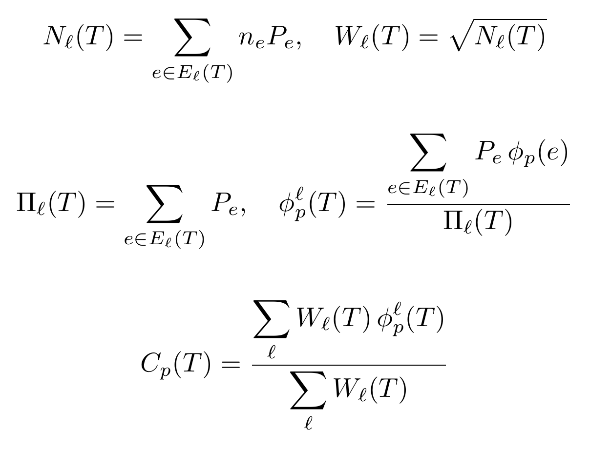
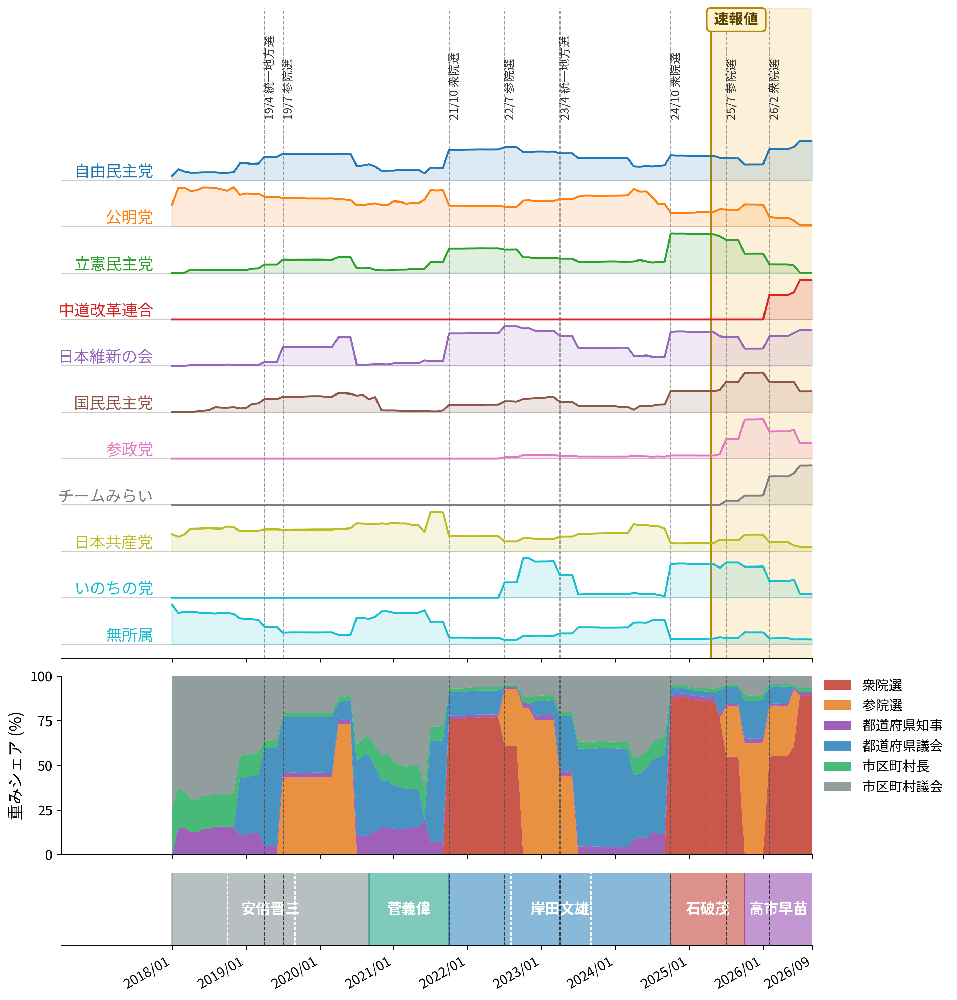
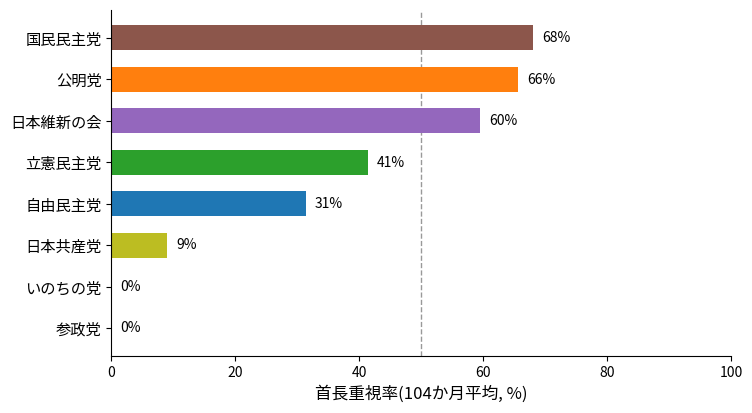
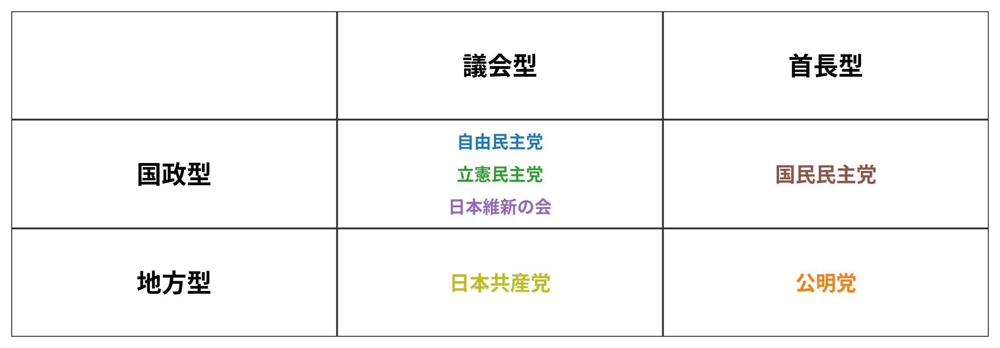

# 党勢指数を作ってみた話(第0回)

## きっかけ

ある政党の党首が党勢の低下を「謀略だ」と主張する一方、支持者は「まだ伸びている」と言っていました。実際どちらが正しいのか、自分で客観的に確かめられる指標が欲しくなったのが出発点です。SNSの言及数は自作自演も混ざりますし、世論調査は「支持政党なし」の割合が大きすぎたり、誤差が数%はあるので最新の政治状況を反映しづらいです。最終的に政党の力は選挙で獲得した議席に収束するはずなので、実際の選挙結果だけから機械的に指標を作ることにしました。

## 指数の設計

作ったのは、政党$${p}$$の党勢を表す指数$${C_p(T)}$$です。
まず、記号を次のように定義しておきます。

- $${\ell}$$: 階層(衆議院・参議院・都道府県知事・都道府県議会・市区町村長・市区町村議会)
- $${e}$$: 階層$${\ell}$$で期間 $${T}$$(直近12か月)のあいだに投票が行われた個々の選挙
- $${P_e}$$: その選挙 $${e}$$ が代表する人口(国会なら全国人口、それ以外はその自治体の人口)
- $${n_e}$$: その選挙 $${e}$$ で決まる議席・ポストの数(都道府県知事・市区町村長は常に1、それ以外は実際の議席数)
- $${\phi_p(e)}$$: その選挙 $${e}$$ で政党 $${p}$$ が獲得した実効的なシェア(首長選挙は推薦・支持を含む、地方議会・国会は届出政党のみ)

選挙は種類(衆議院・参議院・都道府県知事・都道府県議会・市区町村長・市区町村議会の6種類、以下「階層」と呼びます)ごとに規模も数も大きく異なるため、まず階層の中で集計してから、階層をまたいで合成する2段階の式にしています。

**階層内の合成**(都知事選と府知事選など、同じ種類の選挙をする自治体間の選挙)を考えます。人口$${P_e}$$の加重平均$${\phi_p^\ell(T)}$$を使います。$${\phi_p^\ell(T)}$$は、政党$${p}$$を代表(議員・首長)に選んだ人口の割合です。
この加重は、2つの町が合併しても合併前後で政党$${p}$$が代表する人口の総和が変わりません。

**階層をまたぐ合成**(知事1人と議員1議席のように、単純には足し合わせられない異なる種類の代表を釣り合わせる場面)の重みには「ペンローズの平方根則」を援用しています。具体的には、当選者を全員1つの議事堂に集めて多数決させる状況を考え、代表者1人あたりの代表人口の平方根を重みとして足し合わせると$${N_\ell(T)}$$の平方根$${W_\ell(T)}$$という形が導けます(詳細は[設計文書](https://github.com/hiromichikimura-lang/seiryoku-shisu/blob/master/design_document.pdf)を参照)。

集計期間を直近12か月の後方ウィンドウにしているのは、統一地方選のように選挙が特定の月に集中する季節性を、どの時点で切っても機械的にキャンセルできるからです。単月だけで集計すると、選挙が1件しか無い月とその月にたまたま無所属ばかり当選した月とで指数が極端に振れてしまいます。

なお、単純な政党比較は、以下のような慣行の違いがあるため困難です。

- **自民党系候補**: 地方議会選挙で党名を出さず無所属で出馬することが多い。
- **共産党**: ほぼ必ず党名を出す。

一方、**同じ政党の値が時間とともにどう動いたか**は意味を持ちます。
推薦・支持政党データである程度は補正可能ですが、直近の公開遅れ(後述)で補正しきれない分が残ります。

個別に追跡する政党は、政党助成法上の「政党要件」(国会議員5人以上、または直近の国政選挙で得票率2%以上)を満たす政党だけです。それ以外は無所属とまとめて扱います。

## 現在の指数の値(2026年8月時点)

$${C_p(T)}$$を月次で再構成するために、今回は、遡れる限界である2018年1月〜2026年8月の全期間(104か月)を対象とします。

図1は、政党ごとに高さを正規化した党勢指数の推移(1段目)、政党ごとの「地方重視率」の推移(2段目、後述)、「首長重視率」の推移(3段目、後述)、選挙の種類ごとの重みシェアの推移(4段目)、首相の在任期間(最下段)を並べたグラフです。1段目は、同時期に複数の政党がどう動いたかを読み取るためのもので、絶対値の比較はできません。

*図1: 党勢指数の政党別推移(1段目)・地方重視率(2段目)・首長重視率(3段目)・選挙の種類ごとの重みの内訳(4段目)・首相の在任期間(最下段)*

1段目のグラフは無所属を除いて正規化した値です。
無所属は直近数か月ぶんのデータ公開に構造的な遅れがあり、また、統一的な政策集団とはいい難いからです。

首長の推薦・支持データ(地方自治総合研究所「全国首長名簿」)の最新版は2024年5月1日〜2025年4月30日の選挙までしか収録していないため、2025年5月以降を含む12か月ウィンドウは**速報値**として黄色く塗り、それより前を**確定値**としています。新しい年版が公開され次第、全期間を再計算します。

1段目を貫くのこぎり状の動きは、一斉改選される選挙(国政選挙・都道府県議会)が12か月ウィンドウに入るたびに指数が振れ、12か月後に抜けると反動で戻るという機械的な挙動です。個別の山谷はそれぞれ実際の選挙で説明できます。

図1の4段目を見ると、選挙の種類によって3つの挙動に分かれます。

- **市区町村議会**: 自治体数が1700超と最も多く、直近12か月のどの窓にも必ずどこかで選挙が含まれるためシェアがゼロになることはなく(全期間の最低でも4.2%)、全期間平均でも26.8%と6階層中最も高い水準です。ただし国政選挙が重なる月は一桁台まで下がることもあり、常に一定というわけではありません。
- **衆議院・参議院・都道府県議会**: 一斉改選の月の前後だけ急激に割合が高まり(それぞれ最大89.0%・82.1%・56.9%)、それ以外の月はゼロに近づきます。
- **都道府県知事・市区町村長**: 1自治体につき1ポストしか動かない($${n_e=1}$$)ため、平均5.9%・6.4%程度の低い水準で安定して推移します。

特定の選挙の種類が指数を単独で支配し続ける期間は存在しません。

図1の2段目は、政党ごとに、$${\text{地方限定C_p}/(\text{国政限定C_p}+\text{地方限定C_p})}$$を算出した値の推移を示しています。この値を「地方重視率」と呼ぶことにします。
この値は、50%線より上なら地方に、下なら国政に相対的に強いことを意味します。自民党・立憲民主党・日本維新の会・国民民主党は一貫して50%線の下(国政に強い)に位置する一方、公明党・日本共産党は一貫して50%線の上(地方に強い)に位置しており、きれいに二極化しています。公明党の地方組織力(創価学会を背景にした地上戦)や日本共産党の地方議員の厚みは実際によく指摘される特徴であり[^1]、この図はそれを$${C_p(T)}$$の構成要素から裏付けた形です。

[^1]: 国政レベルの政党再編が地方政治に浸透しない理由を分析した先行研究として、上神貴佳「政界再編と地方政治――岩手県釜石市の事例を中心として」(『社会科学研究』59巻3号、2007年)がある。系列関係と大選挙区制を理由に挙げており、着眼点はこの図とは異なるが、2006年時点で都道府県知事の全て・市町村長の99.9%・市区町村議会議員の76.4%が無所属だったという実測は、本稿の首長・地方議員の党派性の薄さと符合する。

図1の3段目は、地方に限定した上でさらに$${\text{首長限定C_p}/(\text{首長限定C_p}+\text{地方議会限定C_p})}$$を算出した値の推移を示しています。
首長とは都道府県知事・市区町村長、地方議会とは都道府県議会・市区町村議会の両者を含みます。この値を「首長重視率」と呼ぶことにします。
こちらは月によって0%・100%近くまで激しく振れており、首長選は件数が少ないため「たまたま直近12か月に誰か当選しているか」だけで大きく変わってしまうことが分かります。実際、直近(2026年半ば以降)は日本維新の会以外ほぼ0%に張り付いていますが、これは**速報値**期間(前述、首長の推薦・支持データが未収録の期間)と重なっており、推薦・支持による無所属首長の政党への振り替えが追いついていないことの影響である可能性があります。実際に確定値期間だけで平均を取り直すと、速報値を含めた平均では首長型に見えていた日本維新の会が議会型に転じるなど、速報値を混ぜると分類が不安定になることが分かりました。そこで確定値期間(88か月)だけで平均を取ると(図2)、国民民主党・公明党は首長型(50%超)、自由民主党・立憲民主党・日本維新の会・日本共産党は議会型(50%未満)という、安定した傾向が出ます。

*図2: 政党別「首長重視率」(全期間平均)*

図1の最下段は首相の在任期間です。色の変わり目が首相交代、同じ色の帯の中にある白い破線が内閣改造(政権交代を伴わないもの)を示します。
首相交代はいずれも衆院選と同時期か選挙結果を受けた指名によるもので1段目・4段目の急変時期と重なる一方、内閣改造の時期には目立った変動が無く、選挙結果が指数を動かしていることの傍証です。

**2024年10月・衆院選**: 自民党が約23%→38%に急伸する一方、公明党は約10%→6%に急落(公明党代表の落選を含む苦戦が実際に報じられています)。ただしこの急伸は自民党自身の躍進ではありません。実際の議席は259から191へ減っており、野党票の分散や一部政党の追跡対象外化により、追跡対象政党どうしの相対シェアで自民党が押し上げられただけです。指数特有の見え方の一例です。

### おまけ: 「地方選は国政選挙の前哨戦」は本当か

政治報道でよく言われる「地方選挙は、次の国政選挙の前哨戦になる」という言説を検証してみました。国会の選挙(衆院選・参院選)を除いた「地方選挙限定の$${C_p(t)}$$」を作り、実際にあった国政選挙の結果と突き合わせています。

**地方の勢いの変化の方向と、国政選挙での議席の増減方向を比べました。** 衆院選・参院選それぞれ連続する2回の組(計4組)について、政党ごとに方向が一致するかを見たところ、6党プールした一致率は50%(12/24)ぴったりで、コイン投げと完全に等しい結果でした。今後、国政選挙が行われるたびにこの表を更新し、傾向が見えてくるか検証を続けます。

**逆方向、つまり国政選挙の結果がその後の地方選挙の動きに持ち越されるかも確認しました。** 少なくとも1か月先までは、国政選挙の勢いが地方選挙側に持ち越される効果は見つかりませんでした。

**ここまでを総合すると、地方選挙は国政選挙の縮図ではなく、ほぼ独立に動いているという描像になります。** 「地方選は国政選挙の前哨戦」という通説は、少なくとも現時点のデータでは裏付けられません。前段(2段目の図)で見た「国政に強い/地方に強い」という政党ごとの構造の違いのほうが、地方選と国政選の関係を説明する軸としては筋が良さそうです。

### おまけ2: 選挙への役立て方

ここまでの結果は、単なる観測にとどまらず、一票の使い方を考える材料にもなりそうです。あくまで一つの見方として、いくつか挙げてみます。

**「型」は、その政党が他党よりどこで強いかではなく、その政党自身がどの舞台を得意としているかを表します。** 地方重視率も首長重視率も、同じ政党の2つの舞台の$${C_p}$$を比べた値です。したがって「公明党は地方型」とは、公明党にとって国政より地方のほうが存在感が大きいという意味であり、地方議会で他党より強いという意味ではありません(政党間の単純比較が難しいことは前述のとおりです)。この読み方に立てば、型は支持政党にとってのホームとアウェイの選挙を見分ける目安になります。たとえば自民党のような国政型の政党を支持している場合、地方議会選挙はアウェイにあたります。地方議会では党の候補が無所属で出ることも多いため、党名だけでなく候補者個人の実績で選ぶ方が実態に合っているとも言えます。

**「議会型」「首長型」も、その政党自身の中での得意な舞台の違いを表すにすぎません。** 議会型は議席を積み上げる形で、首長型は首長選での推薦・支持を通じて、それぞれ存在感を作っていると読めます。ただし首長選は件数が少なく、首長型だからといって首長選で他党より勝ちやすいとは限りません。知事選・市長選では、政党の型よりも個々の候補者と地域の事情を見るほうが確かでしょう。

ただし首長重視率は、速報値期間を含めて平均すると分類が不安定になることが分かりました。日本維新の会は確定値期間(88か月)だけで見ると36.5%(議会型)ですが、速報値期間(16か月)だけで見ると91.7%(首長型)と完全に逆転し、国民民主党も確定値75.3%(首長型)・速報値38.9%(議会型)と逆転します。速報値期間は無所属首長への推薦・支持の振り替えが未反映という構造的な遅れがあるため、確定値期間のみで分類するのが妥当です。「地方重視率」(国政型・地方型、こちらは確定値・速報値のどちらで見ても全党一致する安定した軸です)と、確定値期間ベースの「首長重視率」(議会型・首長型)を掛け合わせると、政党ごとの型が図3のように整理できます。

*図3: 政党の型分類(地方重視率は104か月平均、首長重視率は確定値期間88か月平均)*

参政党・いのちの党も現時点では国政型・議会型に入りますが、履歴が短くサンプルが少ないため参考程度に留めてください。中道改革連合・チームみらいは結成から日が浅く、地方選挙の実績がほぼ無いため分類できません。

**この指数は毎月更新するので、次の統一地方選(2027年4月予定)に向けて、地方重視率・首長重視率がどう動くか定点観測してみる予定です。** 選挙が近づくにつれて各党の構えがどう変化するか(あるいは変化しないか)は、それ自体が1つの見どころだと思います。

いずれも「今のデータから読み取れる傾向」であり、個々の選挙区の事情までは反映していません。参考程度に留めてください。

## 今後について

更新は月1回を目安にします。あくまで個人の趣味の定点観測です。次回以降は最大4本立てで淡々と続けます。

1. 直近月の選挙概況
2. 指数の更新
3. 国政選挙が絡む月のみ、「国政に強い/地方に強い」の分類からの方向の目安
4. 国政選挙のたびに、「地方選は国政選挙の前哨戦」仮説の検証表の更新

## データソース

衆参の議席・地方議会の議席・首長の選挙結果・推薦支持政党データをどこからどう取得しているかは[設計文書](https://github.com/hiromichikimura-lang/seiryoku-shisu/blob/master/design_document.pdf)としてまとめてあり、算出コードとあわせて[GitHub](https://github.com/hiromichikimura-lang/seiryoku-shisu)で公開しています。誰でも検証できる形にしています。

## 著作権について

算出コードはMITライセンスで公開し、自由に使ってもらって構いません。ただしこの記事や設計文書など、文章そのものの著作権は放棄していません。

## AI活用について

指数の設計・データソース調査・実装には、AI(Claude)を活用しています。
