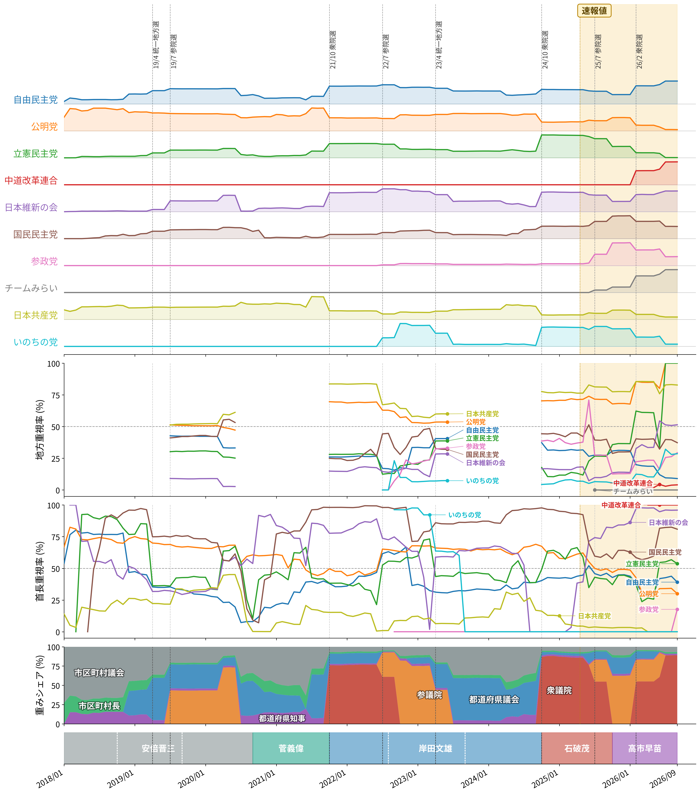

# 党勢指数の定点観測(第1回、2026年9月)

第0回で作った党勢指数$${C_p(T)}$$の、最初の月次更新です。今回は定例の更新に加えて、世論調査の政党支持率との比較を始めることにしたので、その方針も紹介します。

## 選挙講評

2026年9月に実施された選挙は59件でした。内訳は市区町村議会選挙が中心で、ほかに市区町村長選挙と都道府県知事選挙が含まれます。国政選挙はありませんでした。

このうち約半数は沖縄県内の選挙です。9月13日を中心に、知事選挙1件・市町村議会選挙27件・町村長選挙3件が行われました。

最も規模の大きい選挙は沖縄県知事選挙でした。自由民主党・日本維新の会・国民民主党・参政党・公明党沖縄県本部・日本保守党が推薦した新人の古謝玄太氏が42万3124票(得票率59.4%)を得て、立憲民主党・日本共産党・いのちの党・社会民主党・沖縄社会大衆党が支援した現職の玉城デニー氏(27万6060票、38.8%)を破りました。同じ日の市町村議会選挙では、沖縄市議会(定数30)が自由民主党6・公明党4・参政党2・国民民主党2・日本共産党2・立憲民主党1・無所属13、宜野湾市議会(定数26)が自由民主党5・公明党3・参政党1・立憲民主党1・日本共産党1・無所属15という構成になりました。

直近12か月の窓(2025年10月〜2026年9月)に含まれる選挙は834件です。窓の重みの内訳は衆院選が89%と大半を占め、残りは市区町村議会7%、市区町村長2%、都道府県知事2%でした。2026年2月の衆院選が窓に入っている間は、この状態が続きます。

## 指数の更新

8月から9月にかけての$${C_p(T)}$$の変化は、どの政党も0.1ポイント未満でした。表の値は、図1の1段目と同じく無所属を除いて正規化した割合です。無所属は直近の市区町村長選挙の推薦・支持が反映されるまでに時間がかかり、また統一的な政策集団でもないためです。

| 政党 | 9月の値 | 8月からの変化 |
|---|---|---|
| 自由民主党 | 66.6% | +0.08ポイント |
| 中道改革連合 | 10.3% | +0.02ポイント |
| 日本維新の会 | 8.5% | +0.02ポイント |
| 国民民主党 | 6.3% | −0.04ポイント |
| 参政党 | 3.3% | +0.03ポイント |
| チームみらい | 2.3% | 0.00ポイント |
| 日本共産党 | 1.3% | −0.02ポイント |
| 公明党 | 1.0% | −0.07ポイント |
| 立憲民主党 | 0.3% | −0.03ポイント |
| いのちの党 | 0.2% | 0.00ポイント |

変化が小さいのは、上で見たとおり窓の重みの9割近くを衆院選が占めているためです。9月の地方選挙が加わっても、全体の値はほとんど動きません。

### 指数への影響の考察

前月からの変化は、9月の選挙が窓に入った効果と、1年前(2025年9月)の選挙が窓から外れた効果の和になります。この2つに分けると、9月の動きの大半は窓から外れた選挙によるものでした。

| 政党 | 前月差 | 窓に入った効果 | 窓から外れた効果 |
|---|---|---|---|
| 自由民主党 | +0.08 | −0.03 | +0.11 |
| 公明党 | −0.07 | +0.02 | −0.09 |
| 国民民主党 | −0.04 | +0.01 | −0.05 |

窓から外れた選挙で影響が大きかったのは、2025年9月7日の茨城県知事選挙と三重県知事選挙です。どちらも当選者が4党の推薦を受けていました(茨城は自由民主党・公明党・国民民主党・日本維新の会、三重は自由民主党・公明党・立憲民主党・国民民主党)。指数ではこのポストを4党で4分の1ずつ分けます。4分の1は、知事の階層全体での公明党・国民民主党の割合より大きく、自由民主党の割合より小さい値です。そのため、この2つの選挙が窓から抜けると、公明党・国民民主党の値は下がり、自由民主党の値は上がりました。

窓に入った選挙で影響が最も大きかったのは、沖縄県知事選挙です。自由民主党は−0.02ポイント、参政党は+0.02ポイント、公明党は+0.01ポイントでした。勝った陣営に加わっていた自由民主党の値が下がるのは、推薦した6党で1つのポストを6分の1ずつ分けるためです。6分の1は知事の階層全体での自由民主党の割合より小さいので、この選挙が加わると自由民主党の割合は薄まります。9月の市区町村長選挙25件は当選者をすべて無所属として数えているので、無所属を除いた割合は動かしていません。

9月の首長選挙のうち、沖縄県知事選挙の当選者は推薦を受けた政党に按分しています。一方、市区町村長選挙25件の当選者は、すべて無所属として数えているので、表の値には入っていません。この違いは、次に説明する推薦・支持の数え方によるものです。沖縄県内の市町村議会選挙は、他の議会選挙と同じく届出政党の議席数で反映済みです。

### 推薦・支持の数え方を変更しました

今回から、無所属の首長を推薦・支持政党で振り分けるときの基準を変えました。第0回では、地方自治総合研究所「全国首長名簿」の推薦・支持の欄だけを使っていました。この欄は党本部レベルの推薦・支持しか記録しておらず、自民党や日本維新の会の県連による推薦は載りません。また、新しい年版は選挙から1年半ほど後にしか出ないため、直近の首長選挙はすべて無所属のままになっていました。

新しい基準では、いずれかの情報源で推薦・支持が確認できれば、その政党を数えます。政党本部か地方組織か、推薦か支持かは問いません。具体的には次の2つの情報源を使います。

- 全国首長名簿: 推薦・支持の欄に加え、県本部・県連などの推薦を書いた「その他」欄も使う
- Wikipediaの知事選挙の記事: 選挙結果欄の「当選者推薦・支持」を使う(知事選挙のみ)

2つの情報源が食い違うときは名簿を優先します。市区町村長選挙は大半にWikipediaの記事が無いため、名簿の新しい年版が出るまで、直近およそ1年半の選挙は無所属のままです。

この変更は過去の月にもさかのぼって反映しているので、第0回で示した値も変わっています。たとえば2024年6月の公明党は、無所属を除いた割合で26.4%から19.0%になりました。名簿の欄では公明党だけが記録されていた知事選挙で、自民党などの県連の推薦も数えるようになり、按分で公明党の取り分が小さくなったためです。

第0回で書いたとおり、政党どうしの水準は単純には比べられないので、各政党の値が時間とともにどう動くかとして読んでください。

図1は、第0回の図1を2026年9月まで延ばしたものです。

*図1: 党勢指数の政党別推移(1段目)・地方重視率(2段目)・首長重視率(3段目)・選挙の種類ごとの重みの内訳(4段目)・首相の在任期間(最下段)。黄色の範囲は、市区町村長選挙の推薦・支持がまだ名簿に載っていない速報値の期間*

2段目で立憲民主党が2026年7月から100%に張り付いているのは、指数の仕組みによるものです。7月に2025年7月の参院選が12か月の窓から外れ、窓に残る国政選挙は2026年2月の衆院選だけになりました。この衆院選の議席は中道改革連合の名義なので、立憲民主党の国政限定の値が0になり、地方重視率は100%になります。逆に中道改革連合は、地方での実績が2026年の京都府・香川県知事選挙での推薦だけなので、地方重視率は数%にとどまります。どちらも党勢の変化を表すものではありません。

3段目でも、中道改革連合は地方での実績が知事選挙の推薦だけなので100%になっています。また速報値の期間は、市区町村長選挙の推薦・支持がまだ反映されていないため、首長重視率は低めに出ます。この期間の値は参考程度に見てください。

翌月の方向の目安は国政選挙が絡む月だけに出す決まりなので、今回は対象外です。「地方選は国政選挙の前哨戦か」の検証表は、9月に国政選挙が無かったため新しい組は増えていません。ただし推薦・支持の数え方を変えたことで地方選挙側の値が変わり、6党合計の一致は24組中12組から13組になりました(立憲民主党は2組から1組、日本維新の会は2組から4組)。コイン投げと同程度という第0回の結論は変わりません。

## 新しく始めること: 政党支持率との比較

党勢指数は選挙結果だけから作った指標なので、世論調査の政党支持率とどの程度連動しているのかが気になります。そこで今月から、政党支持率を毎月記録して、党勢指数と並べて検証することにしました。

### 使うデータ

政党支持率には、三春充希さん(未来社会プロジェクト)が公開している[各社世論調査の平均値](https://note.com/miraisyakai/n/nf05620cd5f69)を使わせていただきます。三春さんは、調査会社ごとの固有の偏りを補正した上で平均を取っています。

> 各社の世論調査は、調査の手法や質問のかけ方によって、高めの数字が出やすかったり低めの数字が出やすかったりする固有の偏りをもっています。そこで、ここではそうした偏りを打ち消す補正をかけることによって統一的な傾向を得て、さらに平均をとることで精度と解像度を上げています。

1社の調査だけを使うと、その社の手法の癖まで拾ってしまいます。補正済みの平均値であれば、そうした癖をあまり気にせずに済みます。

2026年10月6日更新時点の値は次のとおりです(単位は%、[三春さんの記事](https://note.com/miraisyakai/n/nf05620cd5f69)より)。

| 政党 | 支持率 |
|---|---|
| 無党派 | 37.7 |
| 自民 | 33.2 |
| 参政 | 4.1 |
| 維新 | 3.9 |
| 国民 | 3.4 |
| 立憲 | 2.9 |
| 共産 | 2.7 |
| 公明 | 2.7 |
| みらい | 1.8 |
| 保守 | 1.3 |
| 中道 | 0.5 |
| 社民 | 0.5 |
| いのち | 0.4 |

この表と上の党勢指数の表は、水準どうしを並べて比べるものではありません。支持率は回答者全体に占める割合で、党勢指数は選挙の勝者の構成から作った割合なので、分母も意味も違います。見たいのは、両者の動き方が連動しているかどうかです。

### 検証の方針

時系列どうしの相関は、そのまま計算すると見せかけの相関を拾いやすいことが知られています。たとえば、たまたま両方とも右肩上がりの2つの系列は、互いに無関係でも高い相関を示します。そこで、次の手順で分析します。

1. 政党ごとに、党勢指数$${C_p(t)}$$と支持率$${S_p(t)}$$のそれぞれについて単位根検定を行い、系列が定常かどうかを確かめる。
2. 両方とも非定常(I(1))の場合は、すぐに差分を取らず、共和分(両者の間に長期的な釣り合いの関係があるか)を検定する。
3. 結果に応じて相関の取り方を変える。両方とも定常なら水準で、両方とも非定常でも共和分があれば水準の長期関係で、共和分がなければ前月からの差分$${\Delta C_p(t)}$$と$${\Delta S_p(t)}$$で相関を見る。
4. データがたまったら、ずらした月数$${k}$$ごとの相関$${\mathrm{Corr}(\Delta S_p(t), \Delta C_p(t+k))}$$を計算し、支持率と党勢指数のどちらが先に動くのかを調べる。

ただし党勢指数は直近12か月の選挙をまとめた値なので、ある月の変化には「その月に新しく加わった選挙」と「12か月前に窓から外れた選挙」の両方が混ざります。支持率の月々の変化とは性質が違うため、差分どうしの相関は弱めに出るかもしれません。この点も含めて、結果が出たら検討します。

### 結果が出るのは当分先

三春さんの記事で数値として公開されているのは現在値だけで、過去の推移はグラフでしか見られません。そのため、支持率の時系列は今月から1か月ずつ積み上げていくことになります。党勢指数の10月分が算出される次回の更新で、ようやく最初の1組がそろいます。

月次のデータで検定を意味のある精度で行うには、少なくとも2年程度の蓄積が要ります。相関係数の目安が出始めるのは1年後くらいです。それまでは、この欄では毎月の値を記録していくだけになります。地味な作業ですが、続けていけば支持率と選挙結果の関係を政党ごとに比べられる長期の時系列になるはずです。

## データソース

党勢指数のデータソースと算出方法は[設計文書](https://github.com/hiromichikimura-lang/seiryoku-shisu/blob/master/design_document.pdf)にまとめ、算出コード(今回追加した支持率の記録・分析のコードを含む)とあわせて[GitHub](https://github.com/hiromichikimura-lang/seiryoku-shisu)で公開しています。政党支持率は三春充希さんの[「世論の動向【継続更新】」](https://note.com/miraisyakai/n/nf05620cd5f69)の値を使っています。

## 著作権について

算出コードはMITライセンスで公開し、自由に使ってもらって構いません。ただしこの記事や設計文書など、文章そのものの著作権は放棄していません。

## AI活用について

指数の設計・データソース調査・実装には、AI(Claude)を活用しています。
