# どんな人が参政党に投票したか

「参政党の支持者はリテラシーが高い」と、あるYouTuberが話しているのを見ました。私の印象とは違ったので、公開されているデータで確かめることにしました。調べるうちに、もう一つ面白い構図が見えてきました。参政党の投票者は、れいわ新選組の投票者と属性がよく似ていて、価値観は正反対なのです。さらに、参政党の投票者の多くは外国人の受け入れに否定的で、その中で強く反対する人は4割弱だと分かりました。そして、2026年の衆院選で自民党へ移った人と参政党に残った人では、政策態度より、高市氏と自民党への好感にはっきりした差がありました。

## 使ったデータと限界

分析には、東京大学谷口研究室と朝日新聞社が共同で行い、回答の個票を公開している調査を使いました。

- 2026年有権者調査。全国の有権者3,000人を無作為に選んで郵送で聞いたもので、1,827人が答えています。個票は[谷口研究室のサイト](http://www.masaki.j.u-tokyo.ac.jp/utas/utasindex.html)から誰でもダウンロードできます。
- 2025年参院選の比例で投票した党を聞いた設問を使い、参政党と答えた103人を、他党に投票した1,346人と比べました。
- 年齢と性別の影響をロジスティック回帰で調整し、多くの項目を同時に調べることによる見かけの差をHolm法で補正しても残る差だけを、「差がある」と書きます。
- れいわとの比較、政策態度による有権者の分類、2026年の投票先の比較は、データを見ながら立てた問いで、事前に立てた仮説の検証ではありません。

この調査には大きな限界が一つあります。比例の投票先を答えた人のうち参政党と答えた人の割合は、実際の得票率の6割に届きません(図1)。調査に答えなかった、投票先を思い出せなかった、別の党と答えたなど、理由は分かりません。答えなかった参政党の投票者の性質が違えば、ここでの像は偏ります。誰が答えなかったのか分からないので、得票率に合わせた重み付けもしていません。

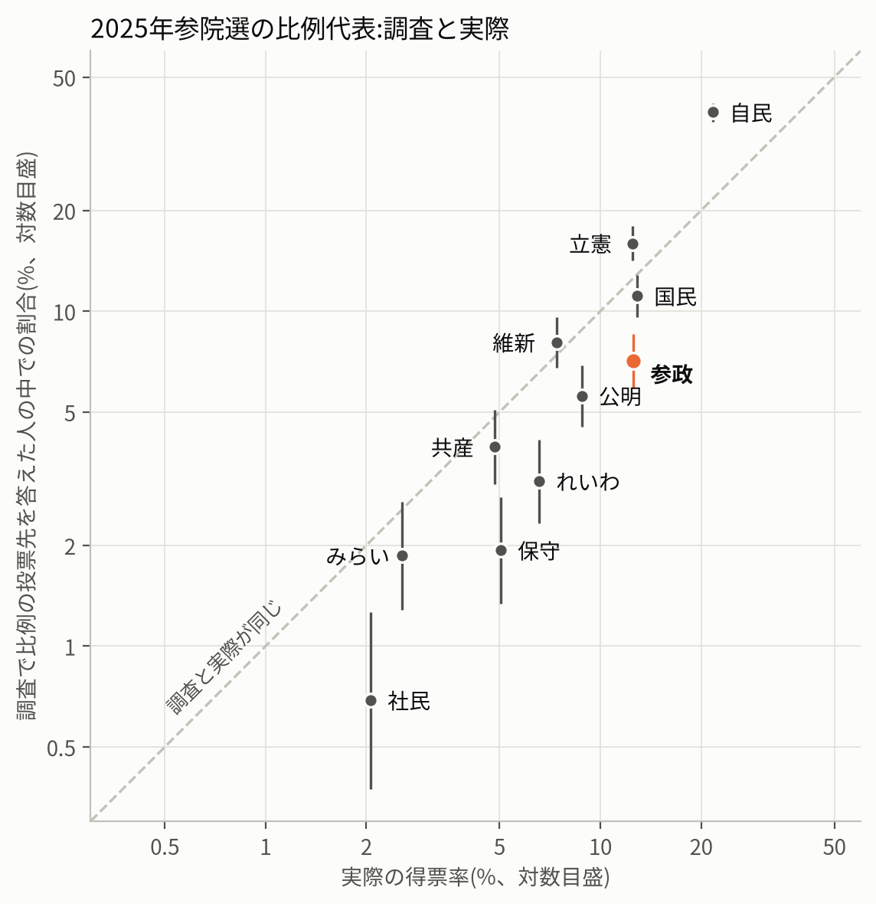
*図1: 2025年参院選の比例代表について、実際の得票率(横軸)と、調査で比例の投票先を答えた人の中での割合(縦軸)。両軸とも対数目盛。縦線は95%区間。破線より下の党は、調査で少なく出ている。実際の得票率は総務省の資料による*

## 先行する分析で分かっていたこと

参政党の投票者については、すでにいくつかの分析があります。

- [田中辰雄氏(横浜商科大学)](https://note.com/tanakatatsuo/n/n995cf9b4fd63)は、ネット調査で同じ人を2024年衆院選から追い、参政党の投票者の中心は20〜40代で、性別・学歴・収入には他党と有意な差がないと報告しています。保守の度合いは自民党の投票者より強く、2021年に自民党に入れた人と、投票しなかった人が主な出どころでした。
- [Peter Chai氏(早稲田大学)](https://theconversation.com/as-japans-popularity-booms-a-new-survey-shows-strong-anti-foreigner-sentiment-283979)は、2026年衆院選後の調査で、外国人に関する2つの質問で参政党の投票者が最も制限的だったと報告しています。
- 梶山佑・山本竜大両氏(『問題と研究』2026年3月号)は、2022年参院選の東大・朝日調査から、参政党などの新興政党の支持は政策より政治不信とメディア利用で説明されるとしています。

この記事で新しく加えるのは、無作為抽出の郵送調査で確かめ直すことと、政策態度を項目ごとに、また投票者の中の層に分けて見ることです。

## 典型的な参政党の投票者

東大・朝日調査で他党の投票者と比べると、参政党の投票者は、40〜50代が多く、学歴は他党と変わらず、政治の情報を新聞・テレビより動画で得る人が多いのが特徴です(図2の上)。男性がやや多いものの、年齢・性別で補正すると差があるとまでは言えません。

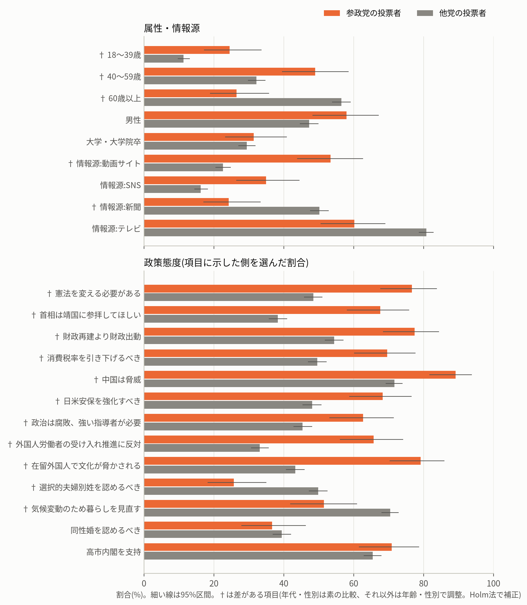
*図2: 参政党の投票者(橙)と他党の投票者(灰)の、属性・情報源と政策態度。細い線は95%区間。†は差がある項目(年代と性別は素の比較、それ以外は年齢・性別で調整。Holm法で補正)*

政策態度では、改憲・靖国・財政出動・減税・中国脅威・日米安保・「政治は腐敗しており強い指導者が必要」に賛成し、夫婦別姓と気候変動対策に賛成しない側に寄っています(図2の下)。最も大きな違いの一つは外国人への態度で、外国人労働者の受け入れ推進に反対する人は3分の2、在留外国人で文化が脅かされると考える人は8割と、どちらも他党の投票者のほぼ2倍です。同性婚と高市内閣の支持には差がありません。

党への結びつきは、自民党以外の多くの党と同じくらいの強さです。今も参政党を支持している人は半分に届かず、これは国民民主党や維新、れいわと同程度です。目立つのは、4人に1人が自民党を支持していることです(図3)。

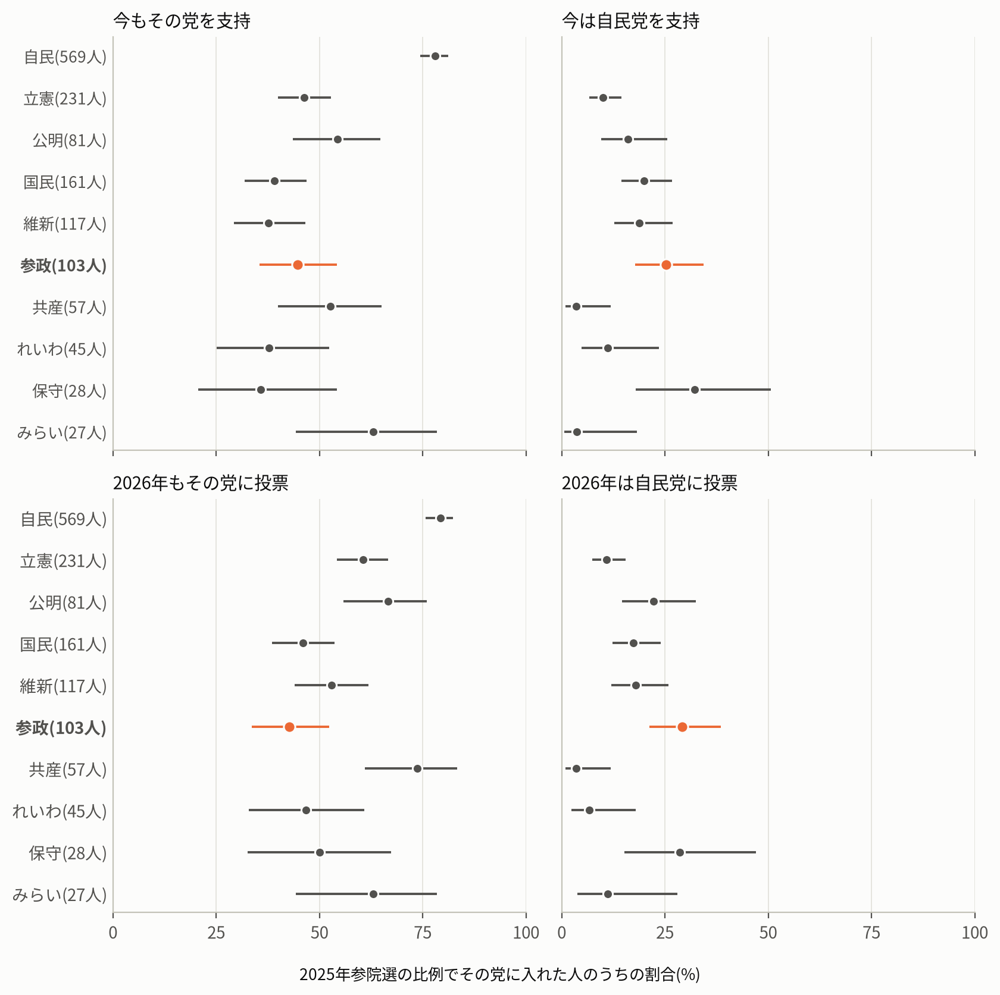
*図3: 2025年参院選の比例で各党に入れた人のうち、今の支持政党と2026年衆院選の投票先が、その党である人と自民党である人の割合。横線は95%区間。立憲と公明は2026年に合流した中道改革連合も同じ党として数えた*

## 「リテラシーが高い」は確かめられたか

冒頭の問いには、はっきりした答えは出せませんでした。この調査には、政治知識のクイズのように、リテラシーそのものを測る設問がないからです。代わりに学歴で見ると、少なくともこの調査では、他党の投票者との目立った差は見られず、高学歴の党とも低学歴の党とも言えません。ここは田中氏の結果と一致します。ただし、学歴はリテラシーの粗い代わりにすぎません。学歴に差がないからといって、リテラシーにも差がないとまでは言えません。はっきり違ったのは情報源で、新聞より動画で政治の情報を得る人が多いことです。ただ、どの媒体で情報を得るかは、リテラシーの高さとは別の話です。

## 参政党とれいわは「同じ層、逆の価値観」

項目を見比べていて目についたのは、れいわの投票者との関係です。YouTubeのモトカ氏の[動画](https://www.youtube.com/watch?v=v2mA6rV4Ii4)は、2011年の反原発運動に集まった人々が、2020年のコロナ禍を境にれいわと参政党へ左右に分かれたと論じています。

主要8党の投票者の全28組について、属性(性別・年齢・学歴・婚姻・職業・生活水準)の違いと、政策態度(20項目)の違いを数値にしたのが図4です。違いは、項目ごとの割合の差を二乗平均した値の平方根(%ポイント)です。人数が少ないと、違いがなくても誤差だけで距離が出るので、その分を差し引いてあります。差し引きすぎて負になった場合は0としました。

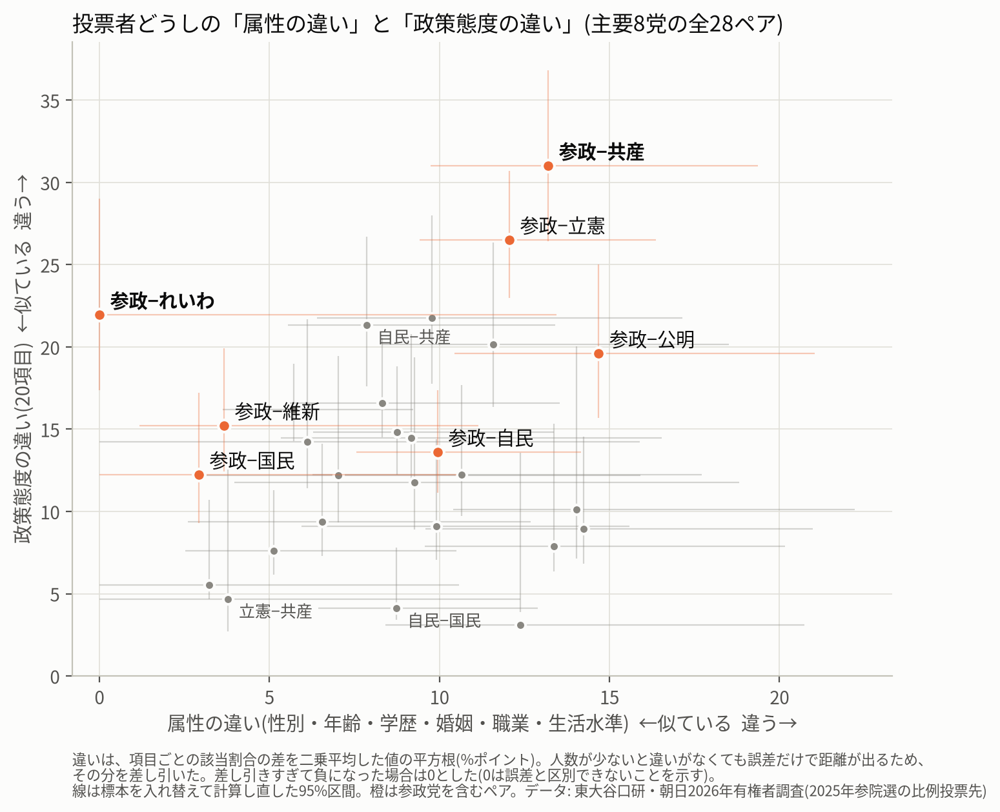
*図4: 主要8党の投票者の全28組の、属性の違い(横軸)と政策態度の違い(縦軸)。0は補正後の推定値が0以下だったことを示す。線は、各党の回答者を選び直して計算し直した95%区間。橙は参政党を含む組。データは東大谷口研・朝日2026年有権者調査*

参政党とれいわの組は、属性の違いがほぼ0なのに、政策態度の違いは自民党と共産党の組と同じくらい大きくなっています。一方、共産党とは、属性でも政策態度でも離れています。モトカ氏は同じ動画で「参政党は共産党の組織論を継承しています」とも述べています。組織の作り方が共産党に似ているとしても、投票者として似ているのはれいわです。

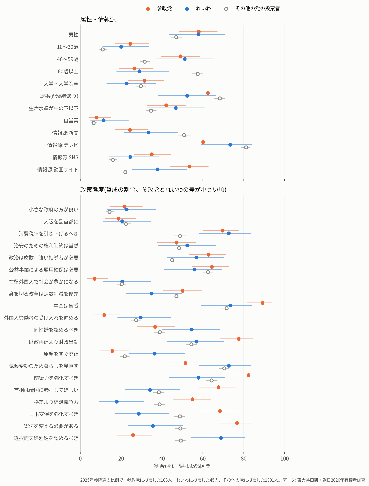
*図5: 参政党(橙)、れいわ(青)、その他の党(白抜き)の投票者の、属性・情報源と政策態度。線は95%区間*

図5で項目ごとに見ると、2党が一致するのは属性と、消費税の引き下げ、「政治は腐敗しており強い指導者が必要」です。反対に、夫婦別姓・改憲・日米安保・靖国・格差より経済競争力では、2党は他党を挟んで反対側に分かれます。属性や一部の政治意識が似た人たちが、右ではナショナリズムを、左では再分配を掲げる党に投票している、という構図がうかがえます。

ただし、れいわに投票した人は45人と少なく、順位はかなり不確かです。各党の回答者を選び直して計算し直すと、参政党とれいわの属性が28組で最も近くなるのは26%で、順位の中央値は5位でした。国民民主党や維新も、属性では参政党に近い党です(図4)。確かに言えるのは、参政党と同じ層から票を集める党のうち、価値観が最も遠いのがれいわだ、というところまでです。

モトカ氏の主張のうち、データと合わない点もあります。動画は自営業者を参政党の中心に挙げますが、参政党の投票者に自営業が多いわけではありません(図5)。また、「原発をすぐ廃止」に賛成する人は、参政党ではその他の党の投票者と同じかやや少ない水準で、れいわとは違います。

## 外国人への反対の強さで分かれる

ここまでは参政党の投票者の平均の像でした。投票先を使わずに有権者を政策態度で分けてみると、参政党の投票者の中には、外国人の受け入れへの反対の強さで違いがあることが分かりました。

分けるのに使ったのは、潜在クラス分析という手法です。似た答え方をする人をまとめて、いくつかのクラスに分けます。対象は無回答の多い人を除く回答者1,781人で、政策態度の19項目を使いました。クラスの数は、当てはまりの良さとモデルの複雑さの釣り合いを見る基準(BIC)で選び、5つになりました。投票先は、分けた後で照らし合わせただけです。

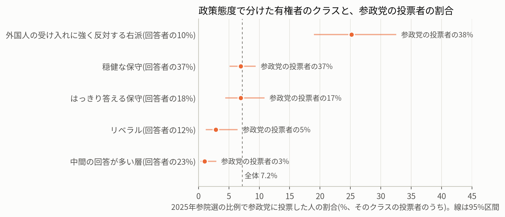
*図6: 政策態度で分けた5つのクラスごとの、2025年参院選の比例で参政党に投票した人の割合(そのクラスの投票者のうち)。線は95%区間。右の数字は、参政党の投票者全体のうち、そのクラスにいる人の割合*

参政党の割合が際立って高いのは、外国人の受け入れに強く反対する右派のクラス(以下、強く反対するクラス)です(図6)。回答者の1割にあたるこのクラスでは投票者の25%が参政党に入れていて、他のクラスの5倍です。このクラスは、外国人の受け入れにほぼ全員が反対し、靖国・中国・防衛では右に寄り、同性婚・夫婦別姓・気候変動対策には消極的です(図7)。

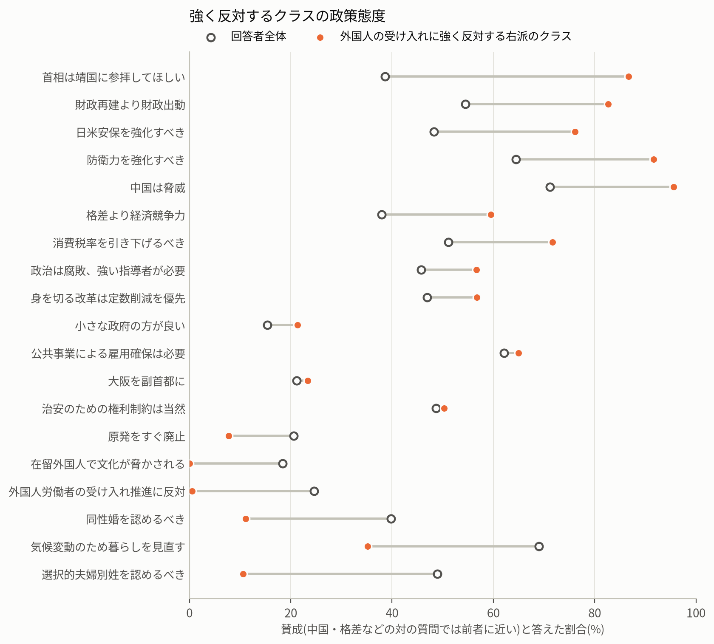
*図7: 強く反対するクラス(橙)と回答者全体(白丸)の、政策態度の各項目の側に答えた割合。外国人の2項目は反対の側*

ただし、このクラスにいるのは参政党の投票者の38%です。残りの多くは穏健な保守の二つのクラスにいますが、そこにいる参政党の投票者も、外国人の受け入れに否定的な側に答えた人が半数から7割います。違うのは強さで、「反対」と言い切る人の割合が強く反対するクラスより低いのです。実際、回答の強さを区別せず「賛成・中間・反対」の3段階で分け直すと、外国人に否定的なクラスに入る参政党の投票者は、クラスの数によって5割弱から7割強に増えます。

逆から見ると、強く反対するクラスの中でも、参政党は多数派ではありません(図8)。2025年の投票先は、自民党が参政党を上回っていました。2026年の衆院選では、このクラスの投票者の半数近くが自民党に入れました。

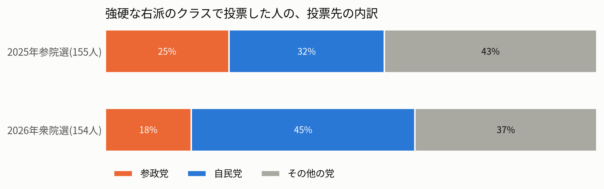
*図8: 強く反対するクラスで投票した人の、2025年参院選(比例)と2026年衆院選の投票先の内訳*

## 2026年に自民党へ移った人

2025年に参政党に入れた人のうち、2026年の衆院選でも参政党に入れたのは4割余りで、3割近くは自民党に入れました(図3)。この二つのグループでは、年齢・性別・学歴・情報源と、靖国・外国人・減税などの政策態度に、補正後の差は見られませんでした。103人をさらに分けた小さな比較なので、差がないとまでは言えません。はっきり差があったのは、0〜10点で聞いた好き嫌いです(図9)。

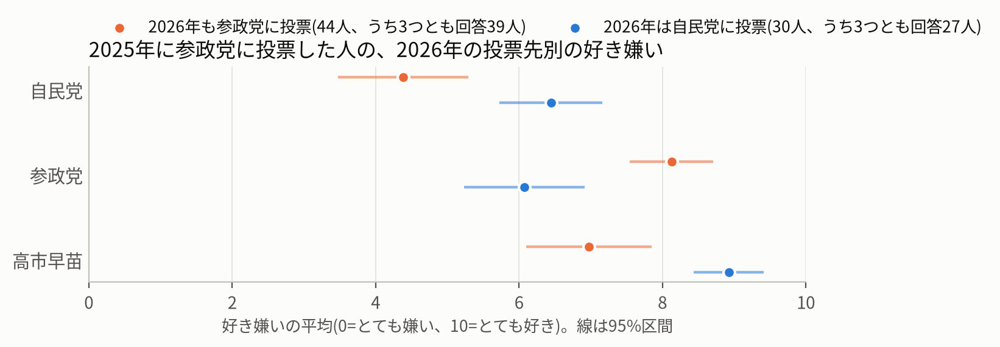
*図9: 2025年に参政党に投票した人の、2026年衆院選の投票先別の、自民党・参政党・高市早苗氏への好き嫌いの平均。線は95%区間。3つとも補正後に差がある*

自民党へ移った人は、高市氏も自民党も高く評価しています。参政党に残った人も高市氏は好いていますが、自民党の評価は低いままです。高市氏への好感が自民党という党への抵抗を上回った人が自民党に入れた、という見方と合う結果です。参政党の主張に最も近い強く反対するクラスでも、自民党に入れた人の94%は高市氏を好いていて(7点以上)、参政党を嫌い(3点以下)、自民党も5点以下という人は6%でした(図10)。

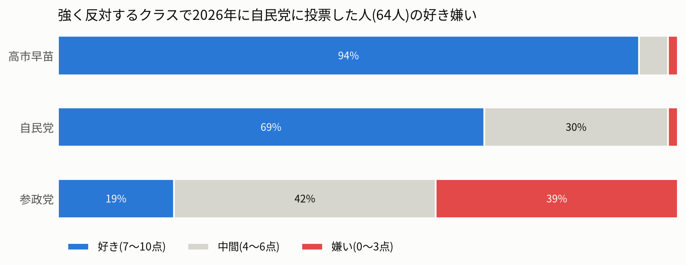
*図10: 強く反対するクラスで2026年に自民党に投票した人の、高市早苗氏・自民党・参政党への好き嫌いの内訳*

ただし、好き嫌いは投票の後(2026年3〜4月)に聞いています。自民党に入れたから高市氏への評価が上がった、という逆向きの関係もありえます。人数も合わせて74人と少ないので、ここは傾向として読むべき結果です。

## 参政党を嫌う人は高市政権を支持するか

逆向きの動き、つまり参政党を嫌う中道・リベラルの人たちが、その対抗として高市政権を支持している様子も探しましたが、見つかりませんでした。どのクラスでも、参政党を嫌う人ほど高市内閣を支持していません(図11)。どの対象にも低い点を付ける人がいるだけでもこの形は出るので、他の5つの対象への好き嫌いの平均で調整しましたが、リベラルのクラスを除いて傾向は残り、逆向きの関係はどこにも出ませんでした。

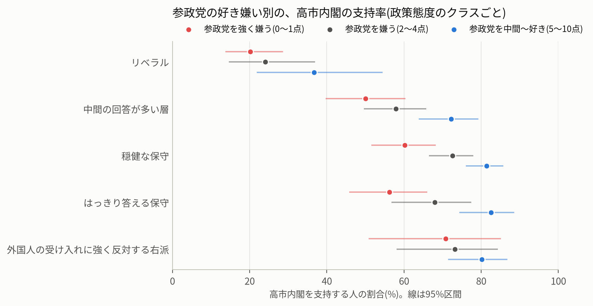
*図11: 政策態度の5つのクラスごとに、参政党の好き嫌い(0〜10点)の段階別に見た、高市内閣を支持する人の割合。線は95%区間*

ただし、言えるのは平均として逆向きの傾向がある、というところまでです。支持の理由を聞いた設問はないので、参政党への対抗から高市政権を支持する人が少しいる可能性までは否定できません。

## おわりに

参政党の投票者の特徴は、学歴ではなく、年代と情報源と価値観にあります。属性だけを見れば、れいわの投票者とよく似ています。属性の似た人たちが、正反対の価値観を掲げる左右の二つの党に分かれて投票している、というのがデータから見える構図です。

参政党の投票者の多くは外国人の受け入れに否定的ですが、強く反対する人は4割弱です。そして2025年に参政党に入れた人の3割近くは、高市政権のもとで自民党に入れました。参政党の伸びしろも弱みも、自民党との間にある、というのが今回のデータからの見立てです。分析の多くはデータを見ながら進めたもので、別の調査で確かめる必要があります。

## 追記(2026年11月21日): 伸びる前からの投票者

公開後、参政党が大きく伸びる前からの投票者についても調べました。東大・朝日の2025年の調査(2024年衆院選の後に実施)で、2024年衆院選の比例で参政党に入れた29人を、本文の2025年の投票者と比べました(図12)。

- 若い世代が多く、YouTubeやXで情報を得る人が多い点、財政出動に賛成し中国を脅威と見る点は、伸びる前から同じでした。
- 一方、選択的夫婦別姓に賛成する人は、伸びる前の投票者では52%と他党並みでしたが、2025年の投票者では26%でした。防衛力の強化や「格差より経済競争力」も、2025年の投票者の方が多めです(区間は重なります)。

伸びる前の支持層は、家族観では他党の投票者と変わりませんでした。2025年の急伸で、家族観でもより保守的な人たちが加わったように見えます。ただし、29人と少ないこと、2024年の投票先は思い出しての回答であること、2025年の調査には外国人についての設問がないことに注意が必要です。

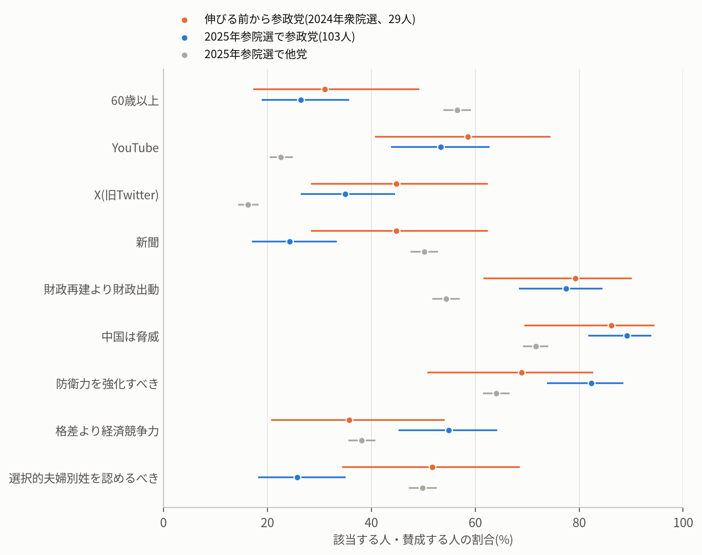
*図12: 2024年衆院選の比例で参政党に入れた人(2025年調査)、2025年参院選の比例で参政党に入れた人、他党に入れた人(2026年調査)の比較。線は95%区間*

## 著作権について

分析のコードは[GitHub](https://github.com/hrkimura/seiryoku-shisu/tree/master/sanseito_profile)にMITライセンスで公開し、自由に使ってもらって構いません。ただしこの記事の文章そのものの著作権は放棄していません。分析に使った個票は再配布が禁じられているので、コードと一緒には公開していません。

## AI活用について

分析の設計・検証・実装と、この記事の下書きには、AI(Claude)を活用しています。

*この記事は東大谷口研・朝日調査データを使用しました。*
