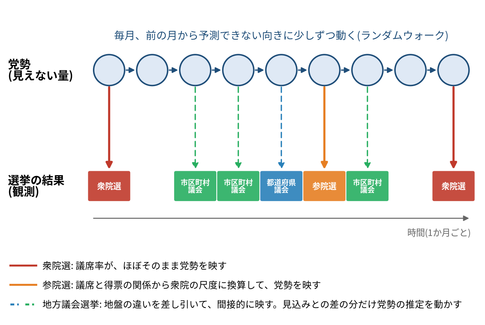
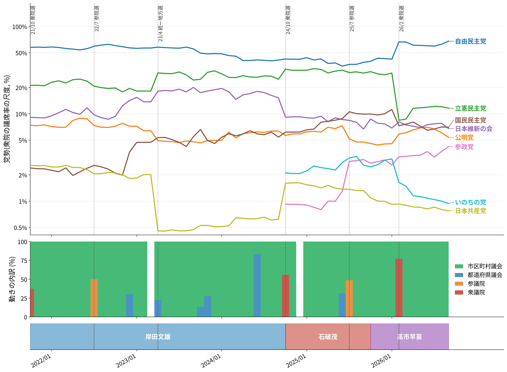
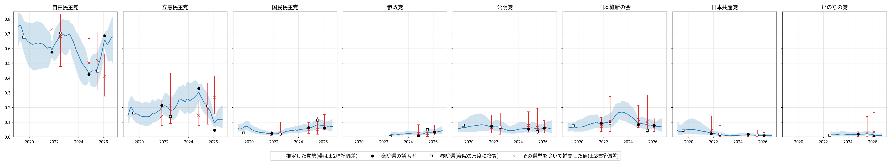
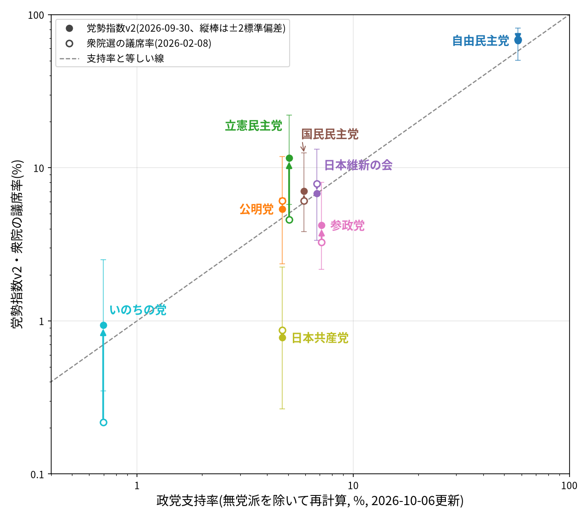

# 党勢指数をv2に作り直した話

これまでの記事で使ってきた党勢指数を根本的に作り直しました。新しい指数を「党勢指数v2」と呼びます。作り直した理由と新しい指数の考え方、それがどれくらい妥当なのかを紹介します。

## これまでの指数の問題点

これまでの指数(以下v1)は、直近12か月の選挙で各党が代表に選ばれた人口を、選挙の種類ごとに重みをつけて足し合わせたものでした。続けるうちに、次の問題がはっきりしてきました。

- **のこぎり状の動き**: 一斉改選の選挙が12か月の窓に入ると指数が跳ね、12か月後に抜けると戻ります。党勢が本当に動いたのか、窓の出入りなのかを区別できません。
- **政党どうしを比べられない**: 値の大きさに意味がなく、図では党ごとに高さをそろえて描くしかありませんでした。自民党が2024年衆院選で議席を減らしたのに指数が上がったように、他党の動きで値が変わることもありました。
- **重みが決め打ち**: 選挙の種類をまたいで足す重みは理屈から決めたもので、データで確かめたものではありません。
- **確からしさがわからない**: 値がどれくらい確かなのかを示せませんでした。

## v2の考え方

v2では、測りたいものを「国政での党勢」に絞り、衆院の議席率(無所属を除く)の尺度で表します。国政選挙は数年に一度しかないので、その間を地方議会の選挙で埋めるという考え方です。

- **党勢は見えない量として推定する**: 党勢は毎月ランダムウォークする見えない量(潜在変数)で、国政選挙はそれをほぼ直接、地方選挙は間接的に映すと考えます(状態空間モデル)。地方選挙の結果は、予想より良かったか悪かったかの分だけ党勢の推定値を動かします。効率的市場仮説をイメージするとよいでしょう。したがって、これまで下がってきたから来月も下がる、とは言えません。勢いのようなものも調べましたが、データからは見つかりませんでした。
- **選挙ごとの影響がわかる**: ある月の党勢の変化は、その月の選挙ごとの寄与にちょうど分かれます。どの選挙で党勢が動いたかを、そのまま読めます。
- **確からしさを帯で示す**: 推定値には幅がつきます。国政選挙の直後は狭く、離れるほど広がります。
- **決め打ちの数を減らす**: 選挙の種類ごとの重みは、データから自動的に決まります。データから推定する定数は17個だけで、残りは総務省の公表値などから計算します。

図1は、この仕組みを模式的に表したものです。

*図1: v2の仕組み。見えない党勢が毎月動き、選挙の結果がそれを映す。国政選挙は直接(実線)、地方議会選挙は間接的に(破線)。選挙の並びは説明のための例*

v1の地方重視率と首長重視率に当たるものは、v2にはありません。v2では地方選挙を国政の党勢の手がかりとして使うので、地方と国政の強さを比べる軸がないからです。v1の重みシェアに当たるのは、党勢の動きのうちどの種類の選挙から来たかの内訳です(図2の2段目)。

## どれくらい当たるのか

v2のいちばんの売りは、妥当性を検証したことです。国政選挙を1回ずつ隠して残りのデータで推定し直し、隠した選挙の議席率を当てられるかを調べました(各党の最初の国政選挙を除く36件)。

地方選挙を使わず、国政選挙だけから前後をつないだ場合と比べると、誤差(二乗平均)は9.8ポイントから7.8ポイントに、誤差の中央値は2.3ポイントから2.1ポイントに下がりました。地方選挙が、国政選挙の間の党勢の動きを実際にとらえています。

うまくいった例を挙げます。

- **参政党の2026年衆院選**: 国政選挙だけでは議席率9.1%と見込むところ、v2は3.2%と見込み、実際の3.3%とほぼ一致しました。
- **自民党の2025年参院選**: 国政選挙だけでは52.7%と見込むところ、v2は39.4%でした。実際は34.5%で、地方選挙に表れていた自民党の退潮を一部とらえています。
- **日本共産党の2026年衆院選**: v2の見込み0.9%に対して、実際も0.9%でした。

一方、地方選挙に兆しのなかった国政だけの大きな動きは当てられません。どの選挙をどう外したかは、後で図3とあわせて見ます。

## 現在の党勢(2026年9月末)

*図2: 党勢指数v2の推移(1段目、その月までの選挙による値)、党勢の動きの選挙の種類ごとの内訳(2段目)、首相の在任期間(最下段)。1段目の縦軸は対数目盛り*

1段目は各党の党勢を、衆院の議席率の尺度で同じ軸に描いたものです。v1と違い、政党どうしの高さを比べられます。各月の値は、過去の選挙だけからオンライン推定したものです。線は各党の最初の衆院選から描いています。それより前は、衆院の尺度に合わせる手がかりがないからです。

2段目は党勢の動きを決めている選挙の内訳を示したものです。大半を市区町村議会が占めることが分かります。これは、市区町村議会選挙がほぼ毎月あるのに対し、都道府県議会選挙はほとんどが4年に1度の統一地方選に集中しているためです。

| 政党 | 党勢 | 8月末からの変化 |
|---|---|---|
| 自由民主党 | 67.8% | +5.3 |
| 立憲民主党 | 11.6% | −0.5 |
| 国民民主党 | 7.0% | −0.1 |
| 日本維新の会 | 6.8% | −1.0 |
| 公明党 | 5.4% | −0.7 |
| 参政党 | 4.2% | +0.5 |
| いのちの党 | 0.9% | −0.1 |
| 日本共産党 | 0.8% | 0.0 |
*表1: 政党別の党勢指数v2(2026年9月末、衆院の議席率の尺度、その月までの選挙による値)と8月末からの変化(ポイント)*

2026年9月末の党勢指数v2の値は表1のとおりです。9月は自民党が5.3ポイント上がりました。9月13日の沖縄県の市町村議会選挙で見込みを大きく上回ったためで、宜野湾市議選だけで2.2ポイント押し上げています。

目を引くのは立憲民主党です。支持率(2.9%)では国民民主党や参政党を下回り、2026年衆院選でも当選者の出身で数えて21議席(4.6%)にとどまりました。それでも地方選挙では見込みどおりの結果を出し続けていて、党勢は衆院選の直後の8.4%から12%前後まで戻っています。地方の地盤は、野党の中でまだ最も厚いと言えます。ただ、その地盤は国政の結果に結びついていません。2026年衆院選を隠して地方選挙から推定すると26.5%になり、実際の4.6%と大きく食い違いました。また、国民民主党(7.0%)や日本維新の会(6.8%)とは推定の幅(図3)も重なっているため、党勢では野党第一党とまでは言えません。

*図3: 政党別の党勢指数v2。帯は推定の幅(±2標準偏差)、●は衆院選、□は参院選(衆院の尺度に換算)、×はその選挙を隠して推定した値。縦軸は対数目盛り*

このモデルの妥当性を検証しましょう。図3は政党ごとに、推定の幅と、隠した選挙の当て具合を重ねたものです。この図の指数はオンライン推定ではなく、その時点から未来の情報も使っています。したがって、図2の値とは異なります。×が●や□の近くにあるほど、地方選挙からその国政選挙を言い当てられたことになります。うまく動作していると言ってよさそうです。

図3で、実際の結果が×の誤差棒(±2標準偏差)の外に出ているのが、当てられなかった選挙です。比例代表の得票率と比べると、外れ方には2種類あることが分かります。

- **票の段階での衝撃**: 自民党の2026年衆院選では、議席率は実際68.6%、v2の見込みは41.2%でした。比例代表の得票率も、地方選挙からの見込み27%を大きく上回る37%でした。高市人気と、異例の早期解散で野党の準備が整わなかったことが要因として挙げられています(加藤創太「高市政権下での経済財政政策」東京財団、2026年3月)。こうした全国的な風は、議員個人の地盤で戦う地方議会選挙には表れにくいと考えられます。
- **議席への変換での衝撃**: 立憲民主党の2024年衆院選では、議席率は実際33.0%、v2の見込みは14.5%でした。一方、比例代表の得票率は2021年の20.0%から21.2%へとほぼ横ばいで、見込み(17%)の幅に収まっていました。この選挙では自民党の比例得票率が34.7%から26.7%に落ちています。立憲の票が増えたのではなく、裏金問題で自民党の票が減り、接戦の小選挙区で立憲が競り勝った結果と考えられます(同資料は、立憲が「裏金問題など自民批判票の受け皿」になったと分析しています)。

前者は党そのものへの支持の急変、後者は相手の失点によるもので、どちらも地方選挙が測る党の地力とは別のところで起きています。これは欠点というより、その選挙の結果が地方選挙からは予想できない「本当の衝撃」だったことを示しています。

なお、図3では2026年衆院選の大勝が前の月にも反映されるため、自民党は石破政権の時期から大きく伸びて見えます。その月までの選挙だけで見ても(図2)、自民党は参院選の後に36.8%から43.3%(2025年11月)へ上がっています。ただ、これは党勢の回復ではなく、推定値の修正です。同じ市区町村の前回の選挙と比べると、政党に属する当選者のうち自民党の割合は、2025年の春も秋も前回より15%ほど少なく、減り方は変わっていませんでした。4月の市区町村議会選挙と6月の都議選で推定値が低く出すぎたため、その後の地方選挙が見込みを上回り、推定値が4月より前の水準(42.5%)に戻ったものです。

## 政党支持率との比較

図4は、三春充希さんが集計している[政党支持率](https://note.com/miraisyakai/n/nf05620cd5f69)(10月6日更新)を無党派を除いて計算し直したものと、党勢指数v2の最新の値(●)、2026年衆院選の議席率(○)を並べたものです。点線より上の党は支持率に比べて党勢が強く、下の党は弱いことを表します。

*図4: 政党支持率(無党派を除いて再計算)と、党勢指数v2(●、2026年9月末)・2026年衆院選の議席率(○)。矢印は衆院選の後の動き、縦棒は推定の幅(±2標準偏差)、点線は両者が等しいところ。両軸とも対数目盛り*

自民党、国民民主党、日本維新の会、公明党、いのちの党は点線の近くにあります。選挙の結果だけから作ったv2と世論調査の支持率が、おおむね同じ大きさになっています。点線より上にあるのは立憲民主党で、党勢は支持率の2.3倍です。前の節で見た地方の地盤の厚さが、ここにも表れています。2026年衆院選の議席率(○、4.6%)では、立憲民主党は逆に点線の下にいます。○から●への差のうち、衆院選の後の立て直しは8.4%から11.6%への部分です。残りは、v2がそれまでの地方選挙も合わせて推定するため、衆院選の時点でも議席率より高く出ていた分です。

日本共産党は点線から大きく下に外れていて、支持率は公明党と同じ4.7%なのに、党勢は0.8%です。ただ、これは支持率と選挙の結果が食い違っているわけではありません。共産党の2026年衆院選の比例代表の得票率は4.4%で、支持率とほぼ同じでした。ずれが生じるのは、得票を議席に変える段階です。2026年衆院選では、共産党は小選挙区で1議席も取れず、議席は比例代表の4議席(0.9%)だけでした。比例代表はブロックごとに議席を割り振るので、得票の少ない党ほど議席に結びつきにくくなります。v2は衆院の議席率の尺度で党勢を測るので、この差がそのまま表れます。

参政党が点線の下にあるのも同じ理由で、小選挙区は0議席、比例代表の得票率7.4%に対して議席率は3.3%でした。一方、日本維新の会は小選挙区で20議席を取り、得票率8.6%に対して議席率7.8%を保っています。

## 動機への答え

党勢指数を作り始めたきっかけは、ある政党の党首が党勢の低下を「謀略だ」と主張する一方、支持者は「まだ伸びている」と言っていたことでした(第0回)。これは参政党の神谷宗幣代表のことです。神谷氏は2026年衆院選の最中の1月31日、「今まではX(旧ツイッター)で拡散されていたが広がらず、3分の1ぐらいに減っている」「ちょっと違和感がある」と述べていました([神戸新聞NEXT](https://www.kobe-np.co.jp/news/senkyo/2026/shuuin/news/zenkoku/202601/0019971216.shtml)、2026年1月31日)。毎日新聞の分析でも、参政党に関するXの投稿は参院選から半数以下に減っていました([毎日新聞](https://mainichi.jp/articles/20260204/k00/00m/010/326000c)、2026年2月5日)。v2で、どちらが正しかったのかを確かめます。

v2で見ると、参政党の党勢は2025年参院選で1.3%から2.9%へ倍以上になりました(図2)。その後、衆院選の前の2026年1月には2.6%に下がっています。ただ、後の選挙も使った値(図3)では、参院選から衆院選まで3.1〜3.3%のほぼ横ばいで、1月の下げは推定の幅(2〜5%)の中の揺れにすぎません。衆院選の議席率3.3%も、1月の見込み2.6%をむしろ上回りました。参院選の議席率12.4%から大きく落ちたように見えるのは、主に衆院と参院の制度の違いによるものです。衆院選の後は伸び続け、2026年9月末には4.2%になっています。

つまり、党勢が落ちていたという前提そのものが、v2では裏付けられません。参院選で急増した党勢は衆院選まで保たれ、その後も伸びています。支持者の「まだ伸びている」の方が、実態に近かったと言えます。SNSでの拡散が減ったのは事実ですが、それは党勢の低下を意味していませんでした。神谷氏自身も、聴衆は参院選より多く「ネットだけグッと下がっている」と話しており、街頭での手応えの方がv2と合っています。参院選のときのSNSの盛り上がりが落ち着いただけ、とも考えられます。

## 注意点

- **帯は狭めに出ます**: 隠した選挙の実際の値が帯に入ったのは36件中30件(83%)で、本来の95%に届きません。国政だけで起きる大きな振れを、モデルが想定していないためです。帯は「地方選挙から見た確からしさ」と読んでください。
- **2026年衆院選の中道改革連合**: 当選者の出身で立憲民主党21議席、公明党28議席に分けています。
- **首長選は使っていません**: 理由は2つあります。1つめは、首長選の党派は推薦・支持からしかわからず、市区町村長選の推薦・支持のデータは選挙の9か月〜1年9か月後にしか公開されないためです。2つめは、首長選を考慮したバージョンも検討しましたが、指数への影響は小さいことです。そこで、地方選挙は、都道府県議会と市区町村議会の選挙だけを使います(10月20日に変更し、図表と数値を更新しました)。
- **日本共産党の国政選挙の間の動き**: 地方議会での議席の割合に比べて国政での得票率が低いため、地方の小さな変化が拡大されて映る傾向があります。2023年の統一地方選の後に0.5%前後まで落ち、2024年衆院選で1.6%に戻ったのはこの例です。

## 今後

今後の月次の記事では、党勢指数v2を使います。毎月、見込みと実際の差が大きかった選挙と、それが党勢をどれだけ動かしたかを紹介します。

政党支持率との比較(図4)も毎月続けます。選挙から推定した党勢と世論調査の支持率がどこで食い違うかを見ることで、今回の立憲民主党のように、地方の地盤と有権者の気分のずれが見えてきます。

## 著作権について

モデルの詳しい定義と検証は[設計文書](https://github.com/hrkimura/seiryoku-shisu/blob/master/notes/trend_model.pdf)に、算出コードは[GitHub](https://github.com/hrkimura/seiryoku-shisu)にあります。

算出コードはMITライセンスで公開し、自由に使ってもらって構いません。ただしこの記事や設計文書など、文章そのものの著作権は放棄していません。

## AI活用について

モデルの設計・検証・実装には、AI(Claude)を活用しています。
